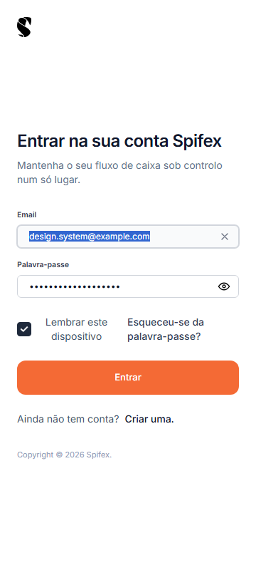
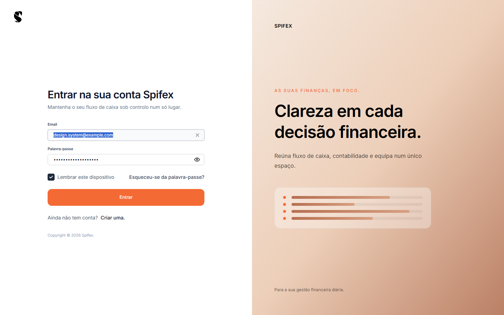
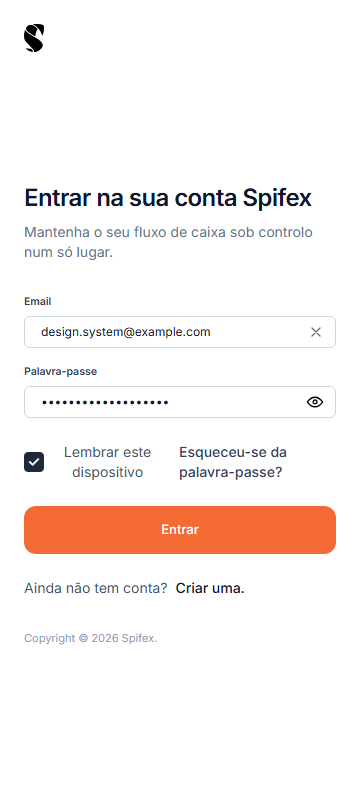
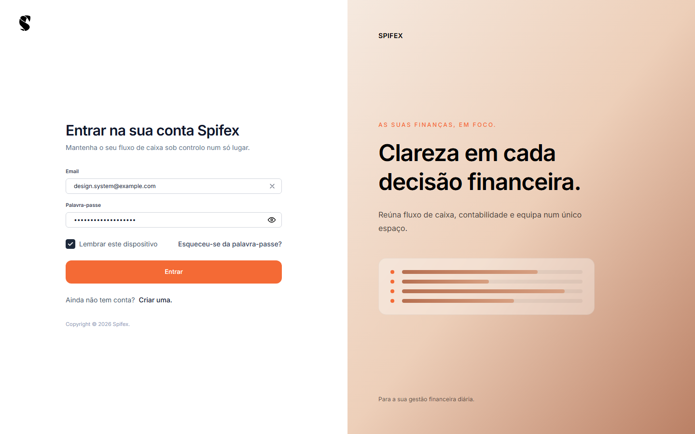
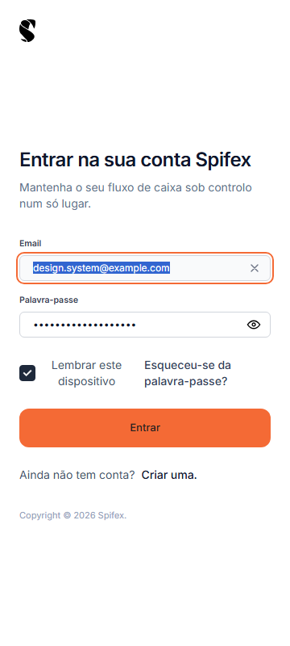
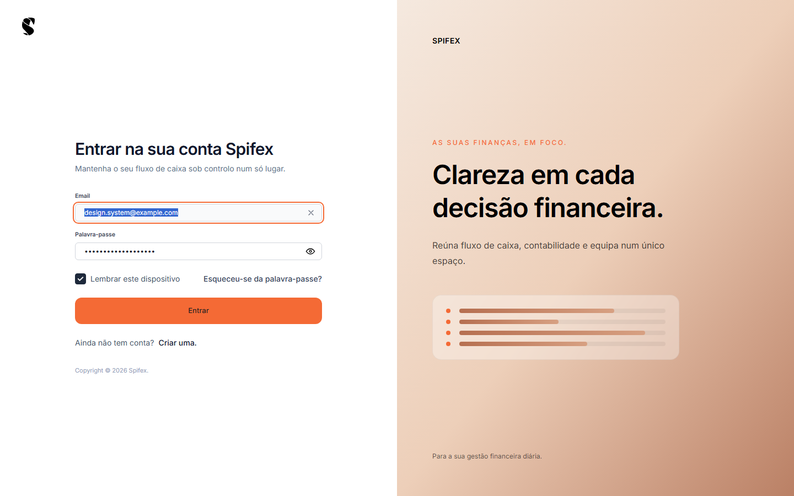
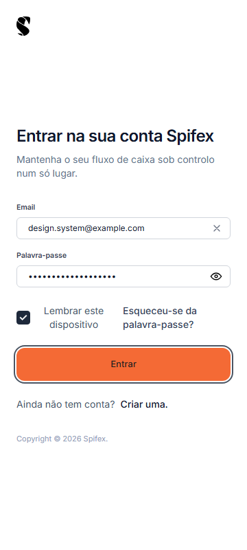
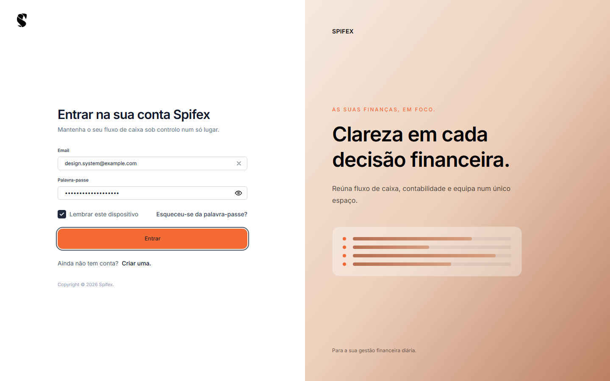

# Phase 1, PR 1 — Evidence

Focus and contrast verification for DS-001–DS-006, DS-031 and DS-038.

Captured with headless Chrome against the Vite dev server at
`http://127.0.0.1:5173/signin`, after filling email/password so the primary
submit button is enabled, and dismissing the cookie banner. Keyboard focus was
produced with real `Tab` key events so `:focus-visible` matches browser
heuristics.

## Before

| 360px | 1440px |
| --- | --- |
|  |  |
|  |  |

Measured:

- Email input: `outline-style: none`, `outline-offset: 0px`.
- Primary button: `color: rgb(255,255,255)` on `rgb(244,106,53)`; outline `none`.

## After

| 360px | 1440px |
| --- | --- |
|  |  |
|  |  |

Measured:

- Email input: `outline: 2px solid var(--accentPrimary)`, `outline-offset: 2px`
  (3.02:1 against white).
- Primary button: `color: rgb(32,32,32)` on `rgb(244,106,53)` (5.40:1);
  `outline: 2px solid #4b5563`, offset `2px` (7.58:1 against white).

The computed outline color sampled during the transition is slightly darker than
the final value; the screenshots show the settled state.

## Contrast summary

| Pair | Ratio | Result |
| --- | --- | --- |
| `#202020` on `#F46A35` | 5.40:1 | Pass (normal text) |
| `#202020` on `#f15a1e` pressed | 4.83:1 | Pass |
| `#202020` on `#9BE7E2` | 11.58:1 | Pass |
| `#ffffff` on `#15803D` | 5.02:1 | Pass |
| `#ffffff` on `#166534` hover | 7.13:1 | Pass |
| `#ffffff` on `#14532D` pressed | 9.11:1 | Pass |
| `#F46A35` focus outline on white | 3.02:1 | Pass (UI, 3:1) |
| `#4b5563` focus outline on white | 7.58:1 | Pass |

## PR 2

Token/config and font cleanup evidence is in
[pr2-token-cleanup.md](pr2-token-cleanup.md).

## Phase 2

Form-control evidence is in [../phase2/README.md](../phase2/README.md).
