# Phase 2, PR 3 — Core form controls evidence

Covers DS-008, DS-011, DS-014, DS-021, DS-027 and DS-028. DS-015 is partially
addressed; DS-022/023 were completed later in Phase 4, PR 13.

Verified with a temporary `.preview/form-controls.tsx` harness (removed after
capture) rendering `Input`, `Select`, `Textarea` and all eight Button variants at
360 and 1440.

## Runtime checks

| Check | Result |
| --- | --- |
| Required labels | `Required name*`, `Required account*`, `Required notes*` |
| Native required input | `input.required === true` |
| Input error | `aria-invalid="true"`, `aria-describedby` points at the error |
| Select | `aria-required="true"`, `aria-invalid="true"`, error id wired, no generic `aria-label` override, red border |
| Textarea | `aria-required="true"`, `aria-invalid="true"`, error id wired, red border |
| Button variants | `primary`, `outline`, `cancel`, `danger`, `common`, `muted`, `ghost`, `outlineBlack` |
| Focus | textarea/select/input show the global 2px accent outline |

## Screenshots

| 360px | 1440px |
| --- | --- |
| 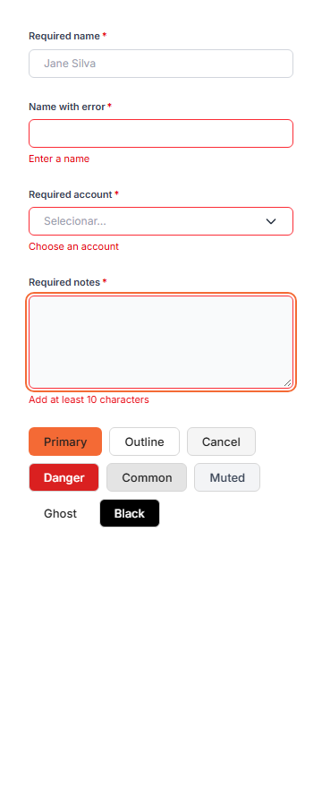 | 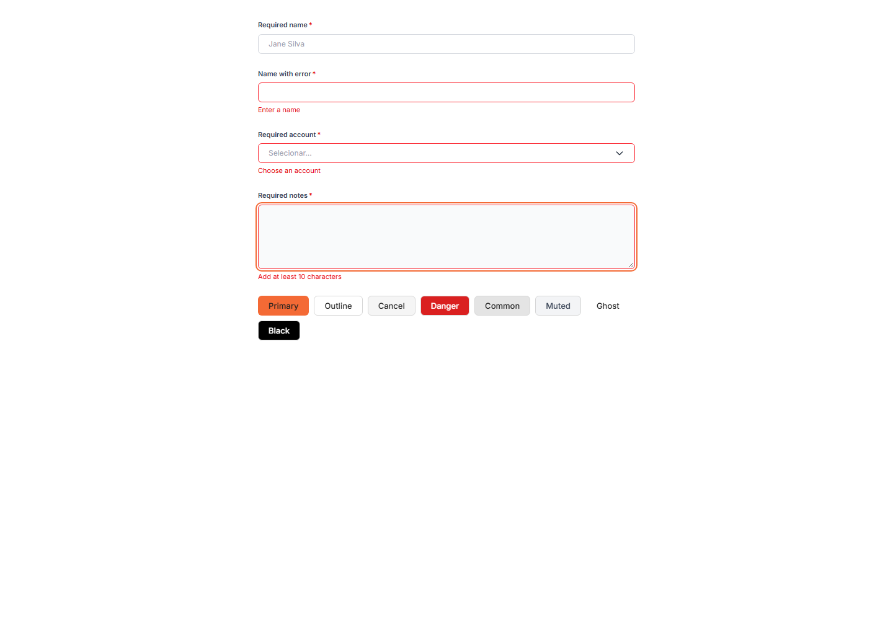 |

## Commands

- `npm run build` — pass.
- `npx --no-install eslint src` — 0 errors, 7 pre-existing warnings.
- `npm run lint` — unchanged; still 24 pre-existing `.preview/*` errors.

## Notes

- `Button` now exposes only eight variants; the removed names are a type error.
- `Textarea` renders the bare field when no label/error is supplied, preserving
  the three migrated accounting/settings layouts.
- DS-015 remains open for the page-level `text-[12px]` / `text-[13px]` sweep.

## Card / Panel (DS-021)

Added `src/shared/ui/Card`. Migrated 12 simple card sites:
`PersonalPermissionRoute` (2), `PermissionMiddleware` (1), `OrganizationSettings`
(1), `ProductBillingSettings` (2), `FinancialCharts` (2),
`PersonalDashboardPage` (2), `OverviewActivity` (2).

Old and new markup measured pixel-identical for the two common recipes:

| Metric | Old compact | New compact | Old slate xl | New slate xl |
| --- | --- | --- | --- | --- |
| Radius | 8px | 8px | 12px | 12px |
| Border | gray-200 | gray-200 | slate-200 | slate-200 |
| Background | white | white | white | white |
| Padding | 16px | 16px | 16px | 16px |
| Size | 344×54 | 344×54 | 344×54 | 344×54 |
| Shadow | none | none | none | none |

| 360px | 1440px |
| --- | --- |
| 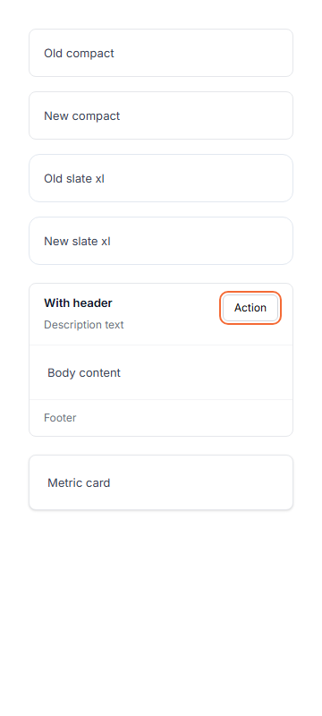 | 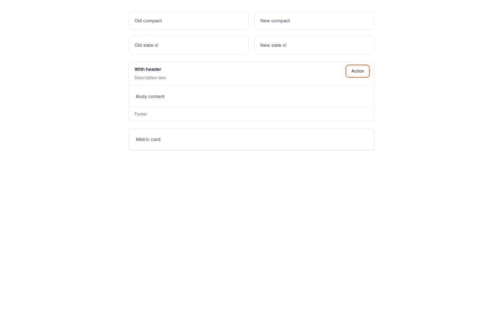 |

The header/footer/action variant is shown in both screenshots. Reporting
`rounded-[24px]`/`[28px]` cards were intentionally left as local exceptions.

## Switch / ToggleSwitch (DS-009)

Both wrappers now use `src/shared/ui/Switch/SwitchControl.tsx`.

| Check | Compact `Switch` | Settings `ToggleSwitch` |
| --- | --- | --- |
| Track | 36×20 | 36×20 |
| Thumb | 16px | 16px |
| Hit area (desktop) | 36px | 44px |
| Hit area (360px) | 44px | 44px |
| Name | `aria-label` + `title` | `aria-labelledby` |
| Description | — | `aria-describedby` |
| Click | toggles `aria-checked` | toggles `aria-checked` |
| Focus | global 2px accent | global 2px accent |

| 360px | 1440px |
| --- | --- |
| 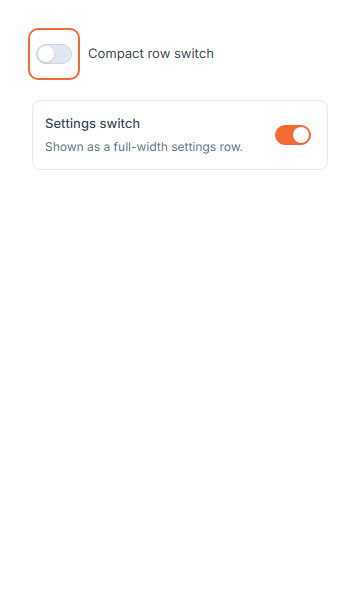 | 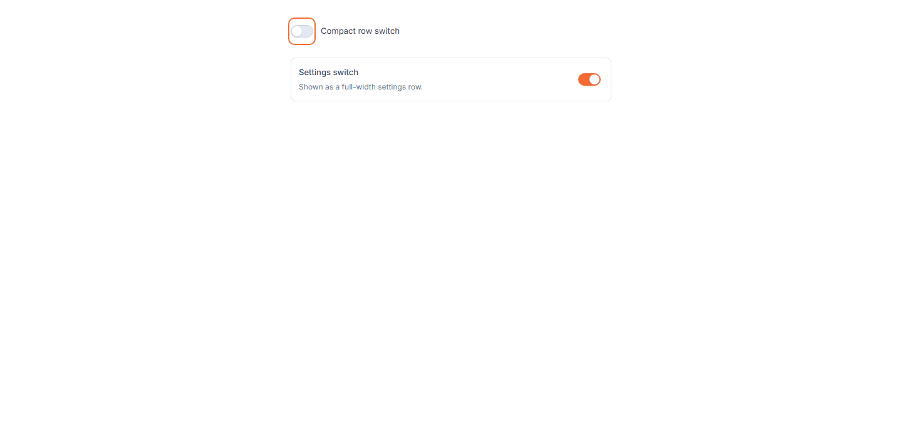 |

## DialogShell (DS-007)

`FloatingDialog`, `ModalShell` and `SidePanelFrame` now share
`src/shared/ui/DialogShell`.

| Check | Center (`FloatingDialog`) | Drawer (`SidePanel`) | Domain (`ModalShell`) |
| --- | --- | --- | --- |
| `role` / `aria-modal` | dialog / true | dialog / true | dialog / true |
| Overlay z-index | 10030 | 10030 | 10030 |
| Scrim | slate-950/35 + blur | slate-950/35 + blur | slate-950/35 + blur |
| Title | 16px | 16px | 16px |
| Close | 32px (44px mobile) | 32px (44px mobile) | 32px (44px mobile) |
| Focus trapped | yes | yes | yes |
| Escape | closes | closes | closes |
| Body scroll | locked, restored | locked, restored | locked, restored |
| Backdrop click | no | preview yes, edit no | no |
| Width | fixed/clamped | 640px | `max-w-3xl` |

| 1440px — FloatingDialog | 1440px — SidePanel | 1440px — ModalShell |
| --- | --- | --- |
| 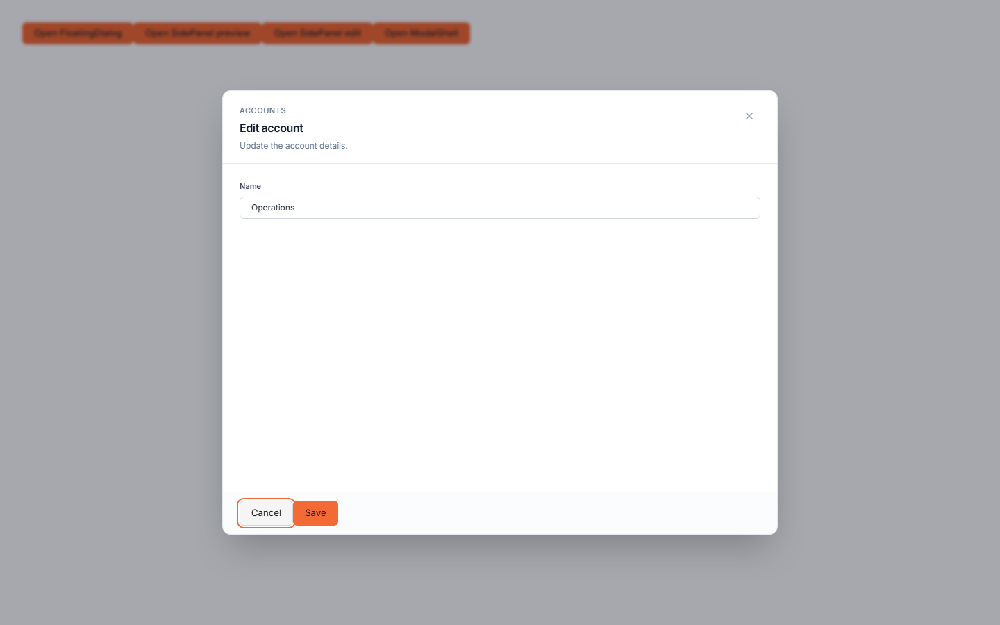 | 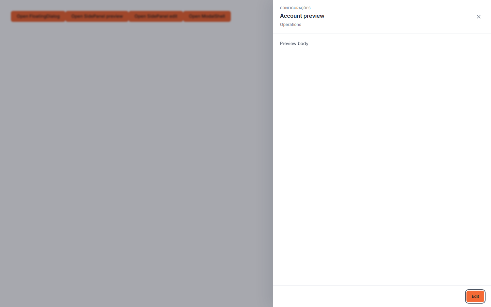 | 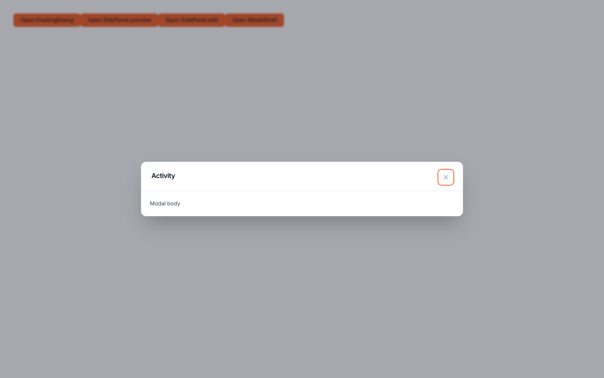 |

Mobile drawer: `dialog-drawer-360.png`.

## Feedback stack (DS-040, DS-042)

All transient feedback portals into `FeedbackStackProvider`:

| Layer | Width | Notes |
| --- | --- | --- |
| Snackbar | 448px (`max-w-md`) | pauses on hover/focus; errors persist |
| ConfirmToast | 320px | `alertdialog`; mobile collapse |
| Selection bars | up to `max-w-3xl` | DataTable, Finance, Personal |

Measured with both a success Snackbar and a ConfirmToast open:

- Stack `z-index`: 15000, bottom 24px (`sm`), 12px gap.
- Snackbar 448×62, confirmation 320×110 — no overlap.
- Success snackbar hides after its timer; error snackbar still visible after 6.2s.
- Focus pause verified via native `focusin`; delayed unmount removes the card after exit.

| 360px | 1440px |
| --- | --- |
| 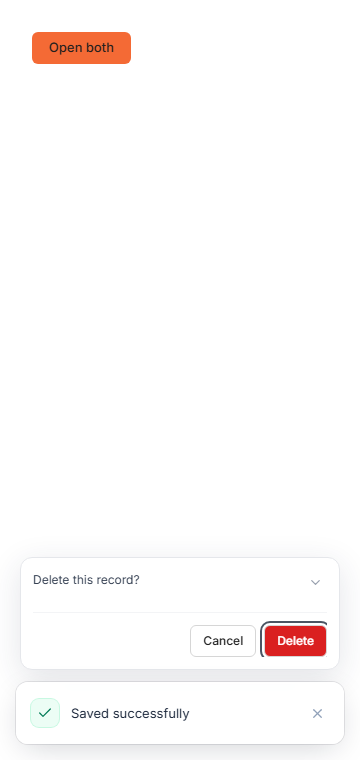 | 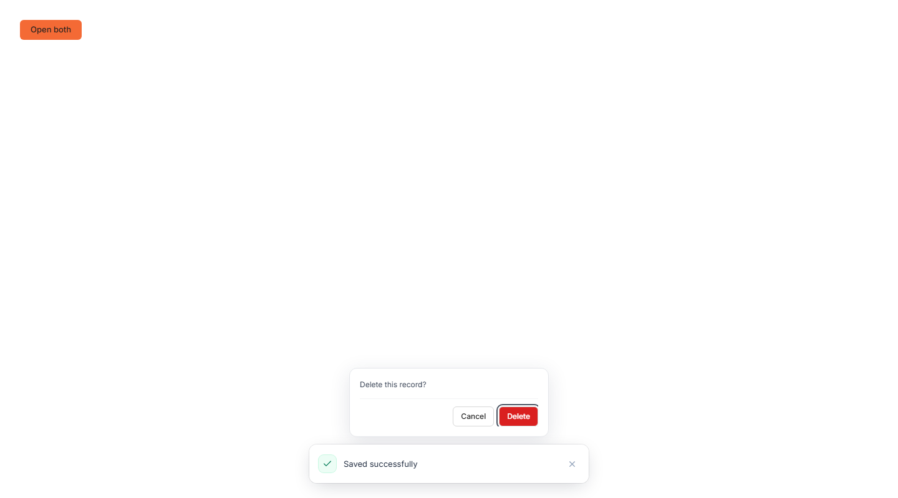 |

## Checkbox (DS-029)

`Checkbox.module.css` now uses component tokens:

| Token | Value |
| --- | --- |
| `--checkboxBorder` | `#cbd5e1` |
| `--checkboxChecked` | `#1e293b` |
| `--checkboxCheck` | `#ffffff` |
| `--checkboxHoverShadow` | `0 0 2px rgb(15 23 42 / 0.2)` |

Measured: unchecked 20×20 with `#cbd5e1` border; checked/indeterminate
`#1e293b` with a white mark; sizes 16/20/24; focus outline 2px accent. The
unused `colorClass` / `myBlueColor` API was removed.

| 360px | 1440px |
| --- | --- |
| 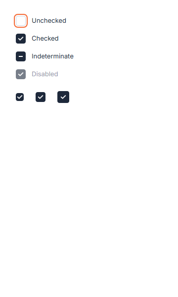 | 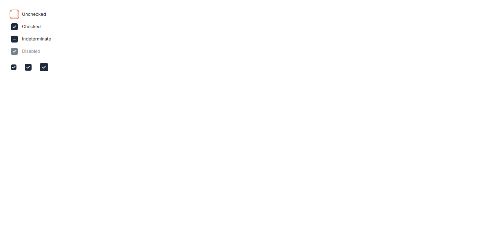 |
