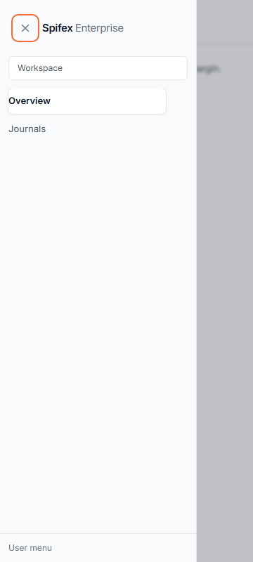
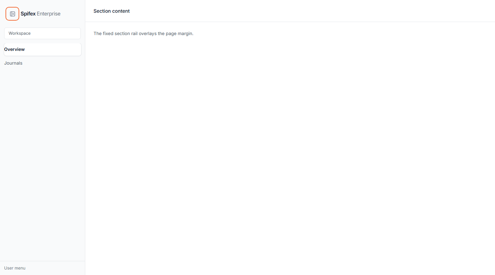

# Phase 3, PR 9 — Sidebar unification and z-index evidence

Covers DS-030 and DS-032.

## SidebarFrame

`SidebarFrame` now has `position="rail"` (workspace, sticky) and
`position="section"` (settings/accounting, fixed) plus `topOffsetPx`.
`SettingsSidebar` and `AccountingSidebar` render their content through it.

Measured with a temporary preview harness (removed after capture):

| Check | Desktop | Mobile |
| --- | --- | --- |
| Rail width | 248px expanded, 72px collapsed | 280px (max 85vw) |
| Position | `fixed` section rail | `fixed` drawer |
| Content offset | `md:ml-[248px]` / `md:ml-[72px]` | none |
| z-index | 50 section / 40 workspace slot | 95 panel / 90 backdrop |
| A11y | toggle `aria-expanded` | `role=dialog`, `aria-modal=true` |
| Focus | visible accent outline | trapped inside, body locked |

| 360px mobile | 1440px section |
| --- | --- |
|  |  |

## Z-index hierarchy

| Layer | Value |
| --- | --- |
| Sticky table header | 10 |
| Navbar | 30 |
| Workspace rail slot | 40 |
| Section rail | 50 |
| Mobile backdrop / panel | 90 / 95 |
| Progress / cookie banner | 9999 |
| Modal layer | 10030 |
| Tooltip / date picker / select | 10050 |
| Anchored popover/menu | 10060 |
| Selection bars above dialogs | 11000 |
| Feedback stack | 15000 |

Removed all `z-[1000000]` values; aligned `FinancialActivityPanel` popovers and
`SettingsPopover` above dialogs.

## Mobile targets (DS-034) and breadcrumbs (DS-033)

- Navbar menu and notification trigger: 44px on mobile, 32px on desktop.
- Sidebar rail toggle: 44px mobile, 32px desktop.
- Personal mobile menu, ConfirmToast collapse, Snackbar close: 44px.
- DataTable row actions: 28px desktop, 44px mobile.
- Breadcrumbs: every `/settings/*` page now renders `Settings > current`
  (currency/formats/limits keep their specific parent); accounting, setup and
  bank-import detail routes keep their section parents. Verified with a path
  matrix for nine representative routes.

## Full-bleed routes (DS-035)

`/cashflow` and `/settled` intentionally hide the workspace rail via
`pageHasActions`; the rule is commented in `ApplicationShell` and documented in
`07-navigation-and-responsive.md`.

## Nested-layer validation (3.6)

Tested at 360px with a nested dialog, parent dialog, mobile sidebar and a
snackbar all present:

| Step | Result |
| --- | --- |
| Open nested | focus trapped in nested dialog |
| Escape 1 | nested closed; parent remained |
| Escape 2 | parent closed; sidebar remained |
| Escape 3 | sidebar closed; `aria-hidden=true` |
| Body scroll | restored to `""` after the sidebar closed |
| Feedback | snackbar remained above the dialog stack |

This exposed and fixed a `SidebarFrame` bug where an inline `onToggle` identity
change caused the captured body-overflow value to become `"hidden"`, leaving the
page locked after close.

## Gray/slate decision (DS-013)

Resolved as an intentional surface rule: `gray` for operational UI and shared
controls, `slate` for settings/reporting/feedback; shared primitives inside
settings keep `gray`. No convergence.

## Commands

- `npm run build` — pass.
- `npx --no-install eslint src` — 0 errors, 7 pre-existing warnings.
- `npm run lint` — unchanged; 24 pre-existing `.preview/*` errors.
